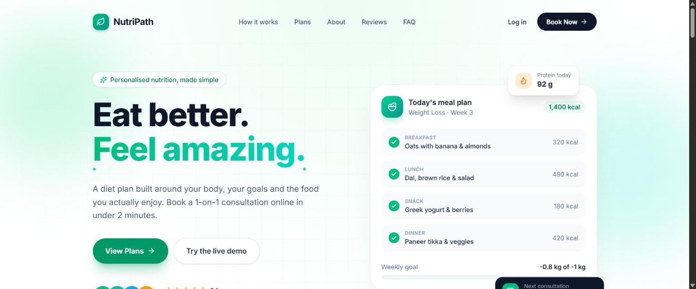
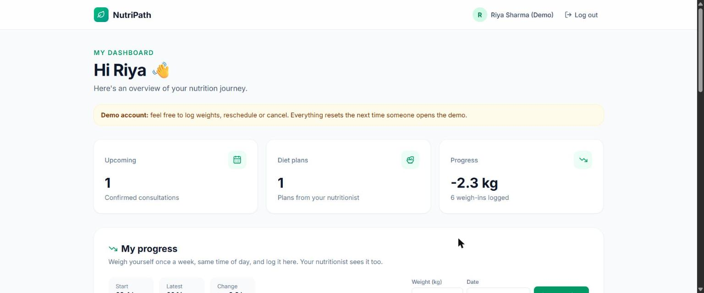

# NutriPath: Nutrition Plans & Consultation Booking

A full-stack booking platform for a nutritionist. Clients browse plans, pick a consultation time, fill in a health form, pay online and get a personalised diet plan in their dashboard. The nutritionist runs everything from an admin panel.

**Live demo:** https://nutripath-liart.vercel.app  
Click **"Try the live demo"** to explore as a sample client without signing up.

> Portfolio project. Payments run in Razorpay **test mode**, so no real money moves. Not a real medical service.



## Features

**For clients**
- Responsive, animated landing page with plans, testimonials and FAQ
- Sign up / log in (email + password, email confirmation)
- 3-step booking: pick a date and time (India time), fill in a health form, pay with Razorpay
- Slots are held for 15 minutes while paying, and two people can never book the same slot
- Dashboard with upcoming consultations, diet plans from the nutritionist, and a **weight tracker with a progress chart**
- **Reschedule or cancel** online up to 24 hours before the call (max 2 reschedules)
- Email confirmations for bookings, reschedules and cancellations (Resend)

**For the nutritionist (admin)**
- Overview: clients, paid bookings, revenue, upcoming calls, alerts for clients waiting for a diet plan
- Bookings with filters (upcoming, past, awaiting payment, cancelled); mark completed or cancel
- Availability: generate weekly slots in one click, add or remove single slots
- Client profiles: health form with BMI, booking history, weight progress chart
- Write and send diet plans from a template
- Plans manager: create, edit, hide plans and change prices (no code changes needed)



## Tech stack
| Area | Tools |
|---|---|
| Frontend | Next.js 16 (App Router, Server Components, Server Actions), TypeScript, Tailwind CSS, Motion |
| Backend | Supabase: Postgres, Auth, Row Level Security, SQL functions |
| Payments | Razorpay Checkout + server-side signature verification |
| Email | Resend |
| Hosting | Vercel (auto-deploys from GitHub) |

## How it's built (highlights)
- **Security first:** every table has Row Level Security. Clients can only see their own data, and only admins can manage plans, slots and bookings. Role changes are blocked by a database trigger.
- **No double bookings:** booking, rescheduling and cancelling run inside Postgres functions that lock the slot, so two people can't claim the same time.
- **Payments can't be faked:** the price comes from the database, never the browser, and a booking is only confirmed after the Razorpay signature is verified on the server.
- **Fast pages:** public pages are cached and refreshed when the admin edits a plan. Logged-in pages are rendered per request.

## Run it yourself
1. Create a free Supabase project and run the SQL files in `supabase/` in order: `schema.sql`, `day4-booking.sql`, `day6-client.sql`.
2. Copy `.env.example` to `.env.local` and fill in your keys (Supabase, Razorpay test keys, optional Resend key).
3. Install and start:

```bash
npm install
npm run dev
```

Open http://localhost:3000. To make yourself admin, run in the SQL editor:
`update public.profiles set role = 'admin' where email = 'you@example.com';`

## About
Built by **Abhishek Tyagi**, full-stack web developer (Next.js, React, Supabase).  
Available for freelance projects: booking systems, business websites, dashboards and web apps.
